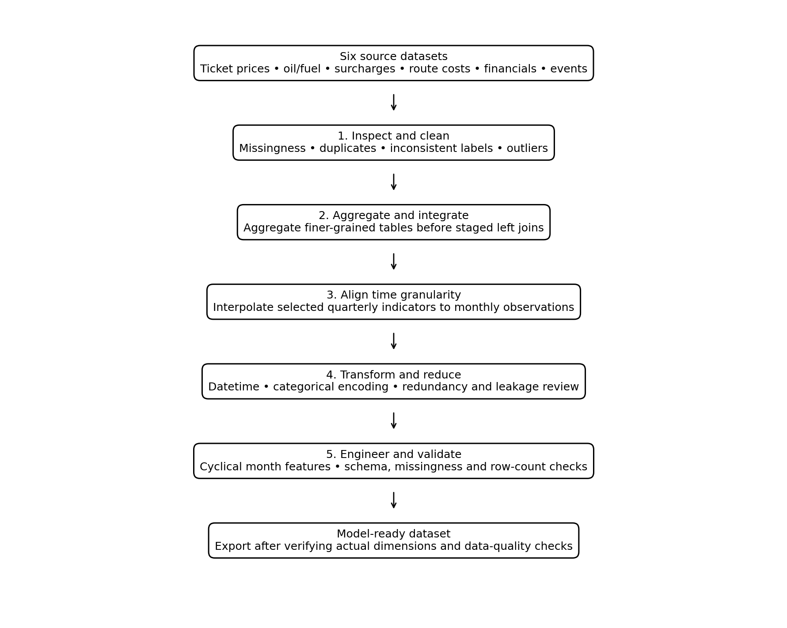

# Global Flight Fare Prediction: Data Preprocessing & Integration

A collaborative Master of Data Science project exploring global flight fare prediction using aviation, oil-market, airline-financial, route-disruption and geopolitical-event data.

**Portfolio focus:** my contribution to data preprocessing and integration. The modelling metrics below are group-level results from the project report, not results attributable to preprocessing alone.

## Why this project matters

Real-world analytical datasets often differ in granularity, data types, completeness and naming conventions. This project integrates six heterogeneous tables and prepares a consolidated dataset for regression modelling.

## My contribution: preprocessing

- **Data inspection and cleaning:** reviewed dimensions, types, missingness, duplicates and outliers; corrected an airline-name inconsistency.
- **Multi-source integration:** used sequential left joins with the ticket-price table as the base.
- **Granularity alignment:** aggregated surcharge and route records to airline-month level before joining, reducing the risk of unintended row multiplication.
- **Temporal alignment:** aligned selected quarterly airline financial variables with monthly observations using interpolation or forward-fill according to variable type.
- **Transformation:** converted temporal and binary variables and encoded ordered and nominal categories.
- **Data reduction:** removed redundant columns and investigated target-derived features that could leak information about the target.
- **Feature engineering:** extracted temporal components and applied cyclical encoding to month-of-year.

> The notebook is adapted from the original group coursework for portfolio presentation. Any additional refactoring or documentation added here is a portfolio improvement and should not be confused with the original group contribution.

## Data sources

The group project used six CSV files from the public Kaggle dataset:

[Airline Ticket Prices vs Oil and Fuel Costs — Kaggle](https://www.kaggle.com/datasets/zkskhurram/airline-ticket-prices-vs-oil-and-fuel-costs)

1. `airline_ticket_prices.csv`
2. `oil_jet_fuel_prices.csv`
3. `fuel_surcharges.csv`
4. `route_cost_impact.csv`
5. `airline_financial_impact.csv`
6. `conflict_oil_events.csv`

The ticket-price table was used as the base table, and `fare_total_usd` was the prediction target. **Raw data is intentionally not included**; please obtain it from the original source and comply with its terms.

## Pipeline overview



The integration strategy aggregates tables with multiple rows per airline-month before joining them to ticket-level observations. Quarterly financial data is aligned to monthly observations using the approach documented in the notebook. These choices involve assumptions and should be reviewed for any new use case.

## Repository structure

```text
global-flight-fare-prediction/
├── README.md
├── notebooks/
│   └── data_preprocessing.ipynb
├── src/
│   └── preprocessing/
│       ├── __init__.py
│       └── utilities.py
├── tests/
│   └── test_utilities.py
├── docs/
│   ├── preprocessing_pipeline.png
│   └── preprocessing_pipeline.mmd
├── reports/
│   └── data_quality_checklist.md
├── data/
│   └── README.md
├── requirements.txt
├── .gitignore
└── LICENSE
```

## Reproduce the notebook

### 1. Create an environment

Python 3.10 or 3.11 is recommended.

```bash
python -m venv .venv
# macOS/Linux
source .venv/bin/activate
# Windows PowerShell
# .venv\Scripts\Activate.ps1

python -m pip install --upgrade pip
pip install -r requirements.txt
```

### 2. Run the notebook

```bash
jupyter lab
```

Open `notebooks/data_preprocessing.ipynb` and run the cells from top to bottom. The original notebook downloads the dataset using `kagglehub`; this requires internet access. If the dataset download fails, download the CSV files from the Kaggle page and update the data-loading cell to point to your local data directory.

### 3. Run the portfolio utility tests

```bash
python -m unittest discover -s tests -v
```

These tests cover the small reusable helper functions in `src/preprocessing/utilities.py`. They do not substitute for executing the complete data pipeline against the source dataset.

## Group-level modelling results

The group report records the following results for a tuned XGBoost model using Recursive Feature Elimination (RFE):

| Metric | Reported result |
|---|---:|
| RMSE | 186.38 |
| MAE | 86.93 |
| R² | 0.9843 |
| Selected features | 22 |

These are results reported by the group for the wider modelling project. They are not a measure of my individual preprocessing contribution. Re-run the modelling workflow and validate the evaluation design before interpreting these scores as expected generalisation performance.

## Limitations and future improvements

- **Time-aware evaluation:** explore a chronological train-test split rather than relying only on random splitting for time-dependent data.
- **Leakage-safe preprocessing:** fit imputers, encoders and feature-selection steps on training data only.
- **Interpolation assumptions:** assess the impact of converting quarterly indicators into monthly estimates.
- **Data validation:** add schema checks, join-cardinality checks and explicit row-count assertions at each integration stage.
- **Reproducibility:** pin dependency versions and record the dataset version and source date.

## Acknowledgements

This was a collaborative group project completed for the Machine Learning for Data Science module at the University of Malaya. The repository highlights my preprocessing focus while acknowledging that modelling and overall project outcomes were produced collaboratively.
